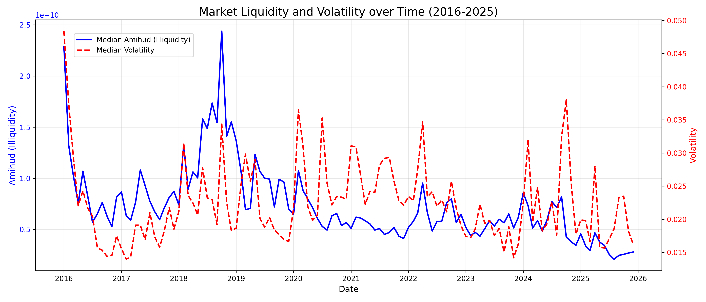
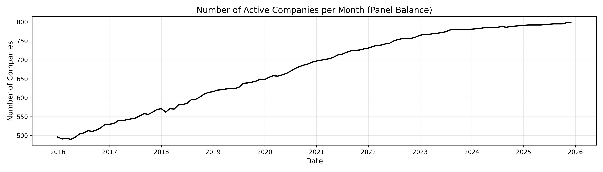
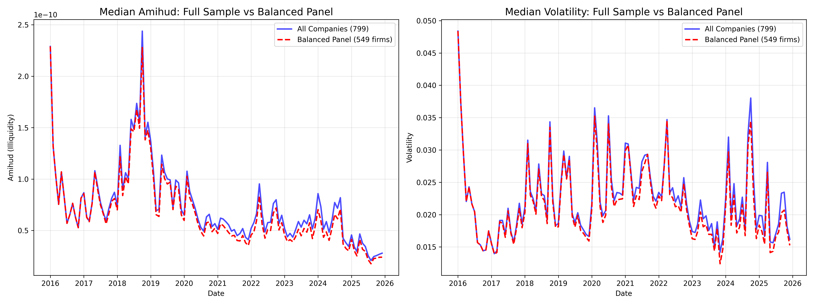
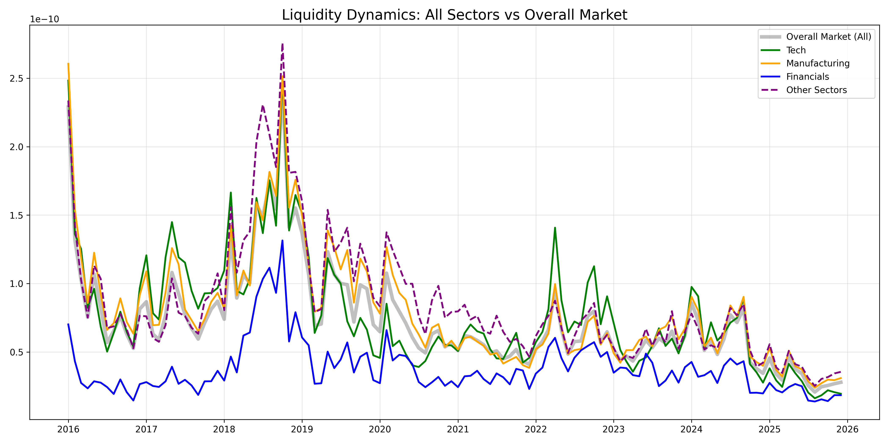
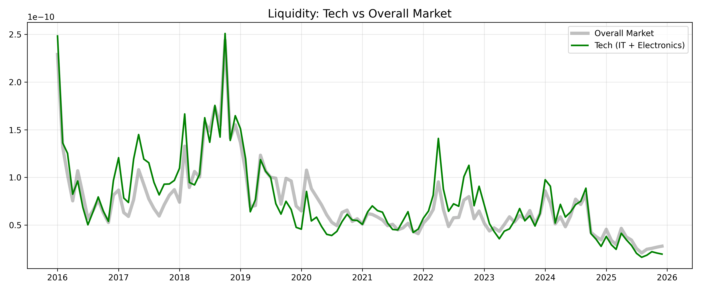
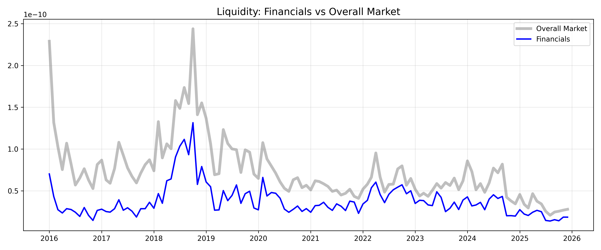
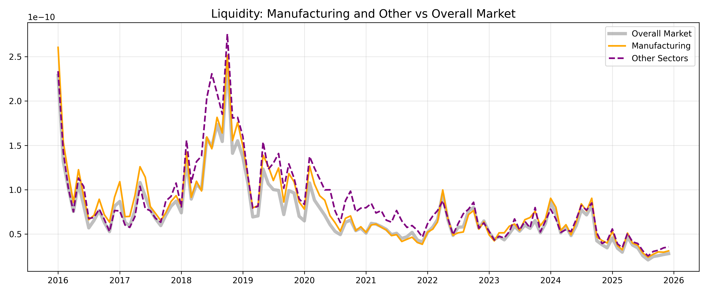

# Exploratory Data Analysis  Report: China A-Share

## 1. Descriptive Statistics (Full Sample)
- **Total observations:** 81,041 (company-month)
- **Number of unique companies:** 799

### Summary Statistics Table
| Variable | Mean | Median (50%) | Std. Dev. | Min | Max |
| :--- | :--- | :--- | :--- | :--- | :--- |
| amihud | 2.3901e-10 | 6.1020e-11 | 8.8571e-09 | 9.0652e-13 | 1.5921e-06 |
| volatility | 2.4479e-02 | 2.1813e-02 | 1.3354e-02 | 1.8343e-05 | 7.6514e-01 |
| Size | 2.4286e+01 | 2.4020e+01 | 1.7758e+00 | 2.0106e+01 | 3.1610e+01 |
| Leverage | 4.8821e-01 | 4.8933e-01 | 2.1859e-01 | 1.4268e-02 | 2.2901e+00 |
| ROA | 4.8656e-02 | 3.9661e-02 | 6.9373e-02 | -2.0354e+00 | 7.3768e-01 |

### Key Takeaways from the Data:
1. **Amihud (Illiquidity):** The distribution of the Amihud measure is strongly right-skewed. The mean (2.39e-10) is almost four times the median (6.10e-11).The median indicates that the typical firm in the sample has low illiquidity, whereas the mean is pulled upward by a small number of observations with extremely high illiquidity.For this reason, it makes sense either to log-transform the measure in the regressions, and to rely on the median rather than the mean when interpreting the results.
2. **Volatility:** Average monthly volatility is (2.45e-02), with a median of (2.18e-02), which likewise points to right-skewness.The range is from (1.83e-05) to (7.65e-01).The maximum value appears to fall in the period of the circuit-breaker crisis in January 2016.
3. **Size (Log Assets):** The average log assets value is 24.29, which is consistent with the profile of large- and mid-cap firms selected from the CSI 300 and CSI 500 indices..
4. **Leverage & ROA (Caveat):** The full-sample average leverage is 48.82% and average ROA is 4.87%. 
**However, these statistics are heavily influenced by financial institutions (banks, brokers), whose debt structure (e.g., deposits) is fundamentally different from non-financial firms.** 
For this reason, the econometric analysis will be conducted separately for financial and non-financial subsamples.

## 2. Market Dynamics (Liquidity and Volatility)
**Figure 1: Market Liquidity and Volatility over Time (2016-2025)**

**Observations:** The chart illustrates the dynamics of median illiquidity (Amihud, blue line) and median volatility (red line) over the 10-year period. We observe several distinct market regimes:

1. **Synchronous Shock (Jan 2016):** At the beginning of the period, both metrics demonstrate a synchronized peak, coinciding with the trading suspension episode (circuit breaker mechanism). This reflects the panic that temporarily froze liquidity.
2. **Divergence (2018-2019):** During this period, illiquidity reaches its maximum for the sample, while volatility remains relatively low. This was likely driven by the US-China trade war and China's de-risking campaign, where liquidity tightened without subsequent price shocks. This is a classic example of a 'liquidity dry-up' without panic.
3. **COVID-19 Shock and Recent Years (2020-2025):** A notable volatility spike occurred in early 2020 at the onset of the COVID-19 pandemic. However, unlike 2016, the illiquidity response was relatively muted, likely due to massive liquidity injections by the Chinese government and a surge in retail trading volumes. Subsequent volatility spikes (2022, 2024, 2025) may be associated with regulatory restrictions in the IT sector, the real estate crisis (e.g., Ever grande), and geopolitical events.
4. **Recent Divergence (Late 2023 - 2024):** We observe a divergence where volatility rises while illiquidity remains at historically low levels. This may indicate market adaptation to shocks, where price fluctuations increase without a systemic freeze in liquidity.

**Implication for the Study:** These historical shocks (2016, 2018, 2020) provide an excellent natural laboratory for our research. They allow us to test whether companies with higher AI innovation (or Tech sector firms) exhibited superior liquidity resilience during periods of extreme market stress.

### 3. Panel Balance
**Figure 2: Number of Active Companies per Month**

**Observations:** The chart shows that our dataset is an unbalanced panel. The number of active companies grew from 490 at the beginning of the period to 799 by the end, reflecting the gradual inclusion of newly listed firms (IPOs). However, because the sample is unbalanced, the changing composition of firms (new, potentially less liquid companies) could potentially drive the aggregate liquidity trends observed earlier. Therefore, it is necessary to compare the full sample with a balanced panel of firms that remained listed throughout the entire period.

### 4. Robustness Check: Full Sample vs Balanced Panel
**Figure 3: Robustness Check (Liquidity and Volatility)**

**Observations:** To address the unbalanced nature of our dataset, we re-estimated the market dynamics using only the **549 companies with continuous history** (i.e., those present in the sample for all 10 years). The overlay chart compares the full sample (blue lines) with the balanced panel (red dashed lines).

**Amihud (Illiquidity):** The lines almost perfectly overlap in shape. The balanced panel is on average slightly lower, which is consistent with the fact that newly listed companies tend to be less liquid. However, the general liquidity trends — including the peaks of 2016 and 2018 — are not determined by the influx of new companies, but reflect genuine market conditions.

**Volatility:** The volatility picture remains virtually unchanged when excluding new companies. The spikes of 2020, 2022, and 2024 are present in both samples.

**Conclusion:** The results confirm the robustness of the dataset. The findings do not depend on composition bias, which justifies the use of the full unbalanced panel for subsequent econometric analysis.

## 5. Sector Comparisons
### 5.1. Overall Market Dynamics by Sector
**Figure 4: Liquidity Dynamics across All Sectors vs Overall Market**

**Observations:** The chart presents the dynamics of illiquidity across sectors. The Financial sector (blue line) consistently exhibits the lowest illiquidity. The Tech sector (green line) deviates from the overall market trend in recent years, while Manufacturing and the remaining sectors closely follow the general market.

### 5.2. Tech Sector vs Overall Market
**Figure 5: Liquidity in the Tech Sector vs Overall Market**

**Observations:** During 2023–2025, the Tech sector demonstrates lower median illiquidity compared to the overall market. This indicates an increase in the liquidity of technology companies, which is likely driven by heightened investor interest in AI and digitalization (establishing causality requires further analysis).

### 5.3. Financial Sector vs Overall Market
**Figure 6: Liquidity in the Financial Sector vs Overall Market**

**Observations:** The Financial sector maintains lower illiquidity than the overall market throughout the entire period. However, during periods of market stress (e.g., 2016, 2020), the gap between them narrows significantly, indicating that even the most liquid companies are vulnerable to systemic shocks.

### 5.4. Manufacturing vs Other Sectors
**Figure 7: Liquidity in Manufacturing and Other Sectors vs Overall Market**

**Observations:** The Manufacturing sector (orange line) almost perfectly tracks the overall market average (gray line). The Other Sectors (purple line) exhibit higher illiquidity, especially during the stress periods of 2016–2018. This may indicate a reallocation of capital from services, retail, and real estate into manufacturing during crises.

